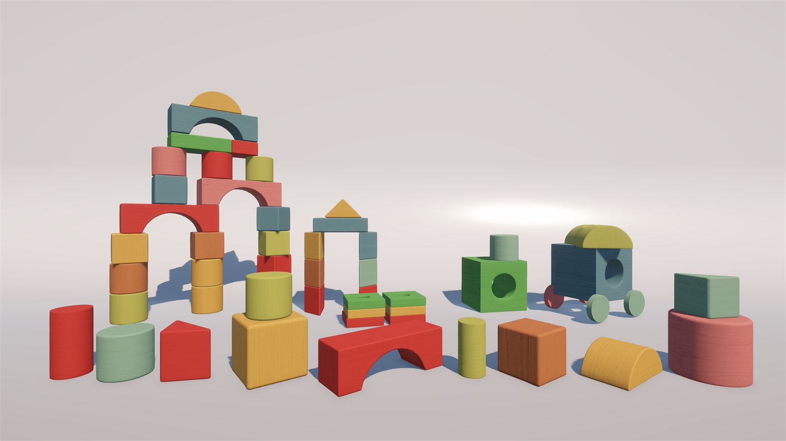
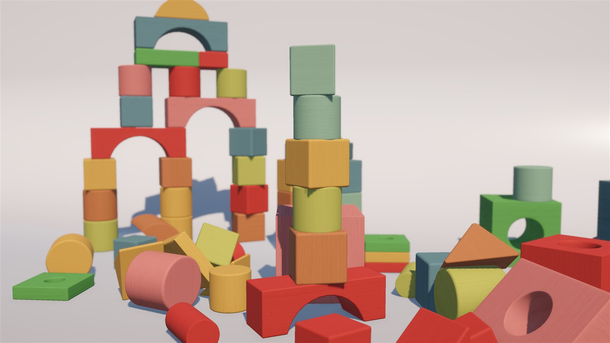
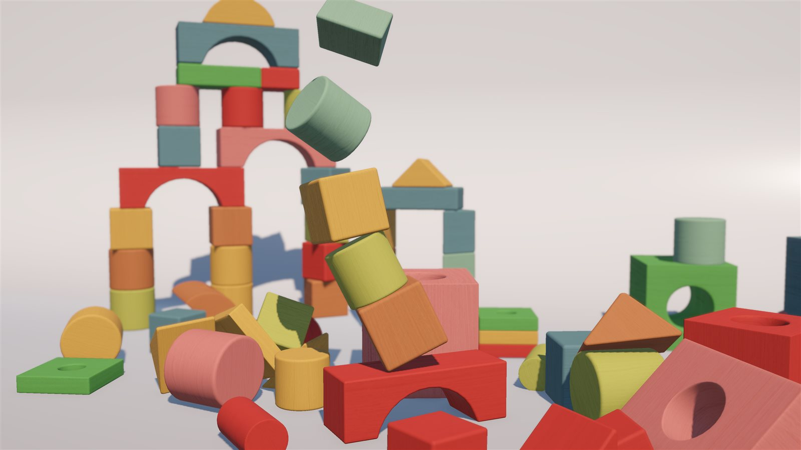
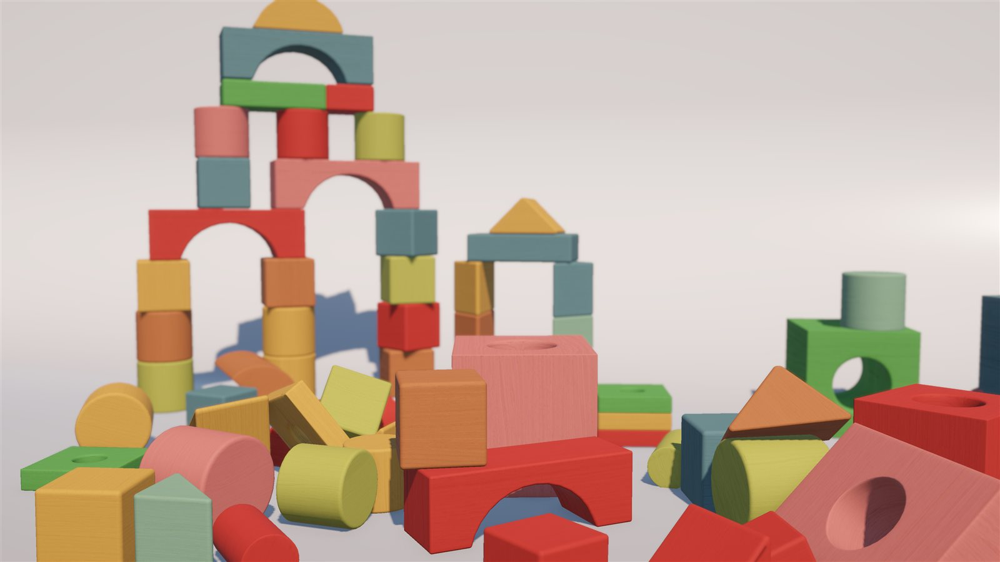

# Hand Block

웹캠 손 인식으로 Unity 속 블럭을 집고, 옮기고, 던지고, 쌓을 수 있는 인터랙션 프로젝트입니다.



## 데모

| 쌓은 탑 | 무너지는 순간 | 무너진 뒤 |
| --- | --- | --- |
|  |  |  |

시연 영상은 [포트폴리오 사이트](https://subinlu22.github.io/)의 Projects → Hand Block 카드에서 볼 수 있습니다.

## 주요 기능

- **집기** — 엄지와 검지를 맞대는 핀치 동작으로 블럭을 집습니다.
- **이동** — 블럭을 집은 상태에서 손을 움직이면 블럭이 따라 움직입니다.
- **던지기** — 핀치를 놓는 순간의 손 속도를 블럭에 실어 던집니다.
- **양손 독립 조작** — 왼손과 오른손이 각각 따로 블럭을 집고 던집니다.
- **손 위치 커서** — 화면에 손 위치를 따라다니는 커서를 표시합니다.
- **회전 모드** — 화면 왼쪽 위 `Rotation` 버튼을 핀치하면 켜지며, 집은 블럭이 손의 기울기를 따라 회전합니다.

## 동작 구조

```
웹캠
 │  영상 프레임
 ▼
Python (hand_sender.py)
 │  MediaPipe Hands로 양손 랜드마크 인식
 │  손목 좌표 + 핀치 여부 + 손 기울기 계산, EMA 스무딩
 ▼
UDP 127.0.0.1:5052
 │  "x,y,grab,roll,pitch,yaw|x,y,grab,roll,pitch,yaw"  (손 0 | 손 1)
 ▼
Unity (HandManager.cs)
    좌표를 월드 좌표로 변환 → 커서 이동 → 집기 / 이동 / 던지기 / 회전 처리
```

## 개발 환경

| 구분 | 내용 |
| --- | --- |
| Unity | 6000.3.11f1 (Unity 6.3 LTS) |
| 렌더 파이프라인 | URP (Universal Render Pipeline 17.3.0) |
| 언어 | C#, Python 3.11 |
| 손 인식 | MediaPipe Hands |
| 영상 입력 | OpenCV (`opencv-python`) |
| 통신 | UDP (포트 5052) |

## 실행 방법

1. Unity에서 프로젝트를 열고 **Play**를 먼저 누릅니다. `HandManager`가 UDP 5052 포트에서 손 데이터를 기다립니다.
2. 가상환경(venv)을 만들고 패키지를 설치합니다. (처음 한 번)

   ```bash
   python -m venv venv
   venv\Scripts\python.exe -m pip install mediapipe opencv-python
   ```

3. 가상환경의 Python으로 손 인식 스크립트를 실행합니다.

   ```bash
   venv\Scripts\python.exe hand_sender.py
   ```

4. 웹캠 창(`Hand Sender`)이 뜨면 화면 앞에서 손을 움직입니다. 종료는 웹캠 창에서 `q`를 누릅니다.

> **주의** — `python hand_sender.py`처럼 시스템 Python으로 실행하면 mediapipe가 설치되어 있지 않아 `ModuleNotFoundError`가 발생합니다. 반드시 패키지를 설치한 가상환경의 Python으로 실행합니다.

## 프로젝트 구조

이 레포에는 스크립트만 올립니다. 블럭 모델, 텍스처, 씬 등 에셋은 포함하지 않습니다.

```
hand-block/
├── hand_sender.py                    # 손 인식 → UDP 전송 (Python)
├── Assets/
│   ├── HandManager.cs                # 손 데이터 수신 및 블럭 조작 (Unity)
│   └── Editor/
│       └── BlockSetupWindow.cs       # Tools > Block Setup 에디터 도구
└── docs/                             # README 이미지
```

| 파일 | 역할 |
| --- | --- |
| `hand_sender.py` | 웹캠 영상에서 MediaPipe로 최대 두 손을 인식합니다. 손목 좌표, 엄지·검지 거리로 판정한 핀치 여부, 손 기울기(roll·pitch·yaw)를 계산하고 좌표는 EMA로 스무딩한 뒤, 손마다 고정된 슬롯(손 0, 손 1)에 담아 UDP로 Unity에 보냅니다. |
| `HandManager.cs` | 별도 스레드에서 UDP 데이터를 받습니다. 정규화 좌표를 카메라 기준 월드 좌표로 바꿔 커서를 움직이고, 핀치 시작 시 커서 근처 블럭(`Block` 태그)을 집습니다. 최근 프레임의 손 속도를 기록해 놓을 때 던지기 속도를 정하고, 회전 모드 버튼 UI를 만들어 켜져 있으면 손 기울기 변화만큼 집은 블럭을 회전시킵니다. 바닥 밖으로 떨어진 블럭은 시작 위치로 되돌립니다. |
| `BlockSetupWindow.cs` | 가져온 블럭 모델을 게임에서 쓸 수 있는 블럭으로 일괄 변환하는 에디터 창입니다. |

## 에디터 도구

- **Tools > Block Setup** — 블럭 모델의 피벗을 가운데로 옮기고, 기준 블럭의 태그·레이어·Rigidbody·스크립트와 크기에 맞는 Box Collider를 붙이며, 선택 시 원래 색을 유지한 나무 재질을 입힙니다.

## 출처

- Block model: ["Children's building block toys"](https://sketchfab.com/3d-models/childrens-building-block-toys-3b8606a158864297b8d8a982bba9c192) by Chenchanchong, licensed under [CC BY 4.0](https://creativecommons.org/licenses/by/4.0/) (modified: scale, texture)
- Wood texture: [Poly Haven](https://polyhaven.com/) (CC0)
